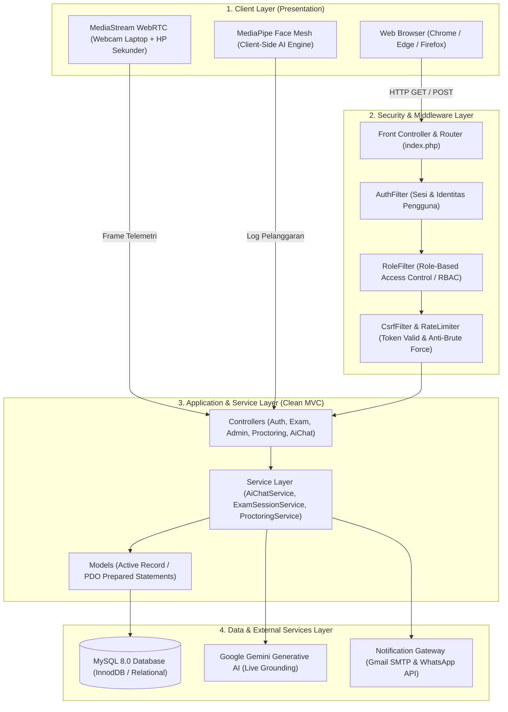
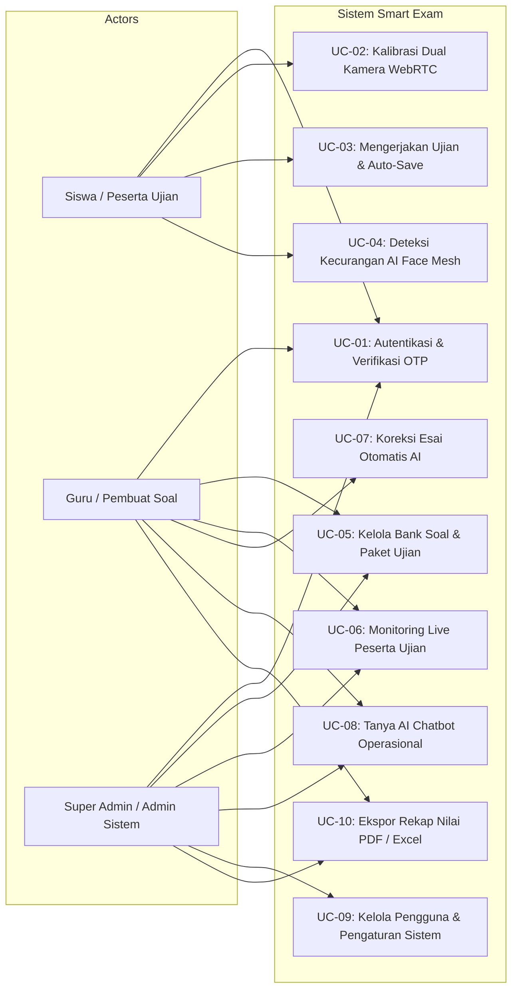
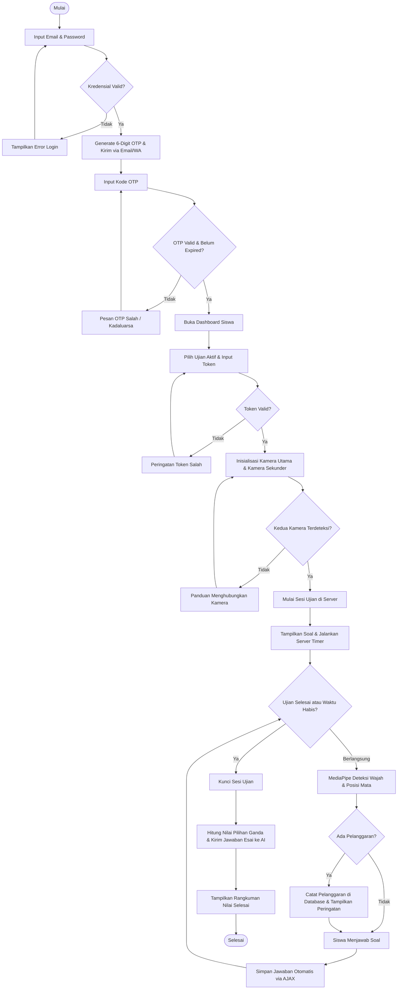
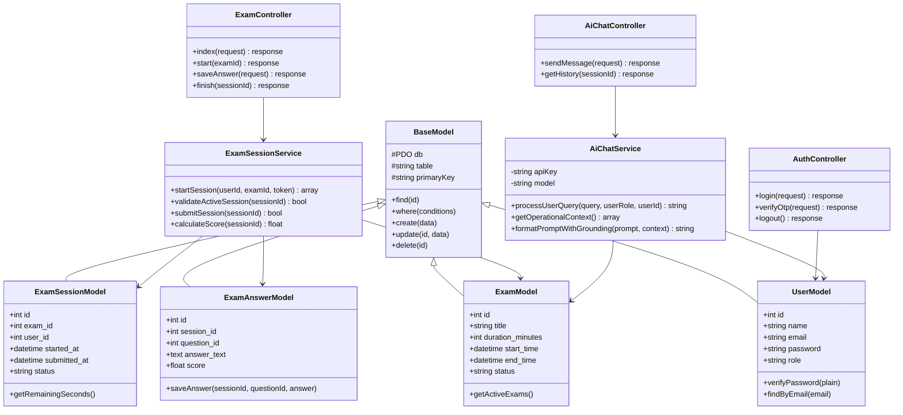
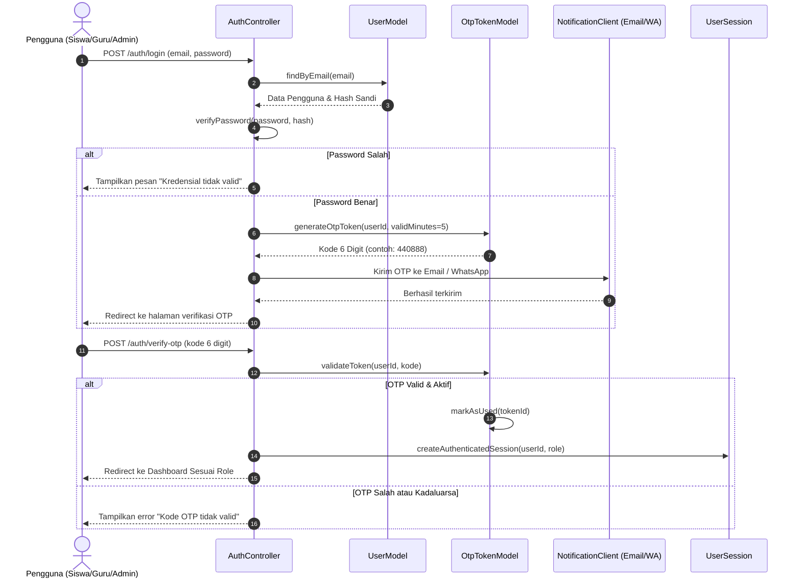
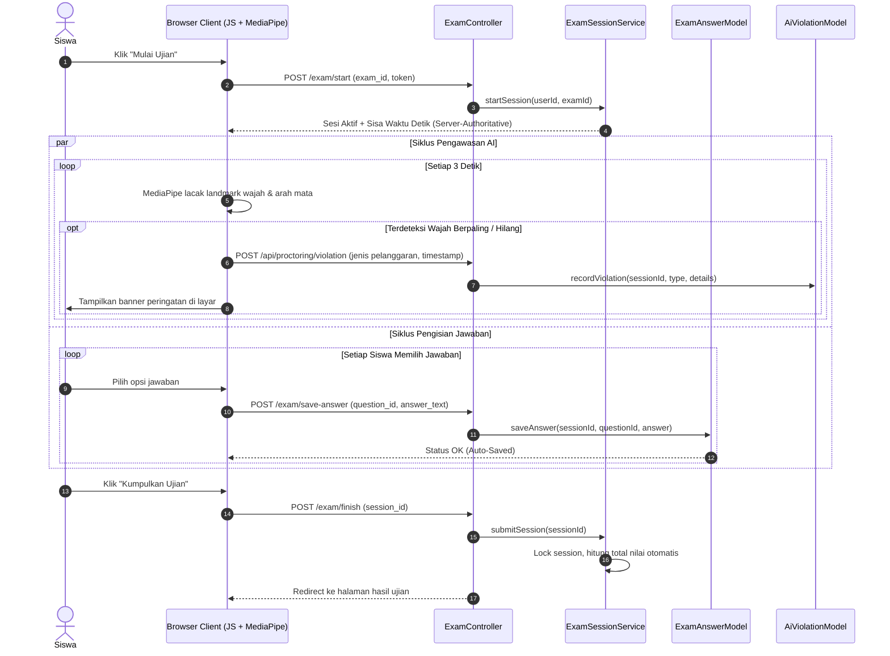
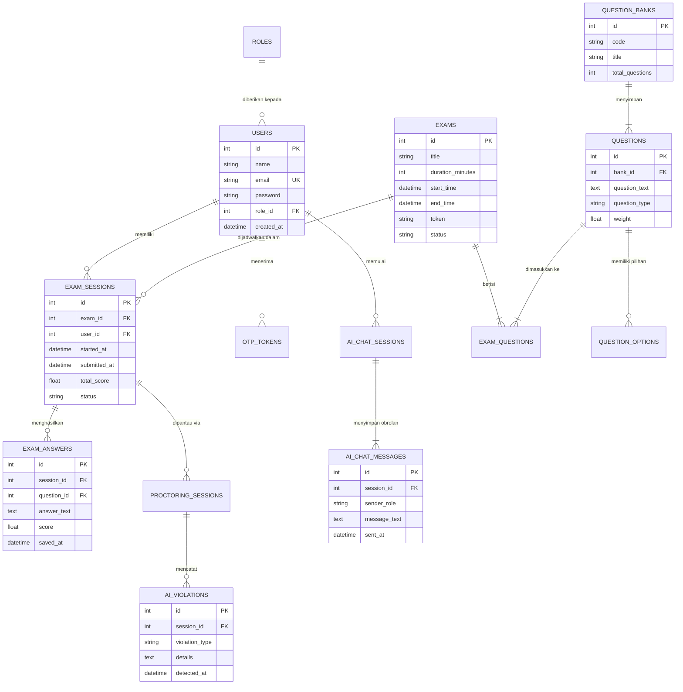

# DOKUMEN PERANCANGAN PERANGKAT LUNAK (SDD)
## Smart Exam — Sistem Ujian Online Berbasis AI & Dual Camera Proctoring

> **Mata Kuliah**: Rekayasa Perangkat Lunak (TIKB2503021) — 4 SKS  
> **Dosen Pengampu**: Yudhistira Arie Wijaya, M.Kom., CDS.  
> **Institusi**: S1 Teknik Informatika — STMIK IKMI Cirebon  
> **Tahun Akademik**: 2026/2027 (Semester 3)  
> **Penyusun**: **Salsa Nabila** (NIM: **41257158**)  
> **Kelompok**: **Tiba Tiba Talun**  
> **Tema Topik**: **E-Learning & Smart Education AI**

---

## 1. ARSITEKTUR PERANGKAT LUNAK

Sistem Smart Exam dirancang dengan arsitektur **3-Tier Clean MVC (Model-View-Controller)** yang dilengkapi lapisan **Service Layer** dan **Middleware Filters** untuk mematuhi prinsip *Separation of Concerns (SoC)* dan *Single Responsibility Principle (SRP)*.

---

## 2. DIAGRAM UML (UNIFIED MODELING LANGUAGE)

### 2.1 Use Case Diagram

#### Skenario Use Case Utama (UC-03: Mengerjakan Ujian dengan AI Proctoring)
- **Aktor Utama**: Siswa
- **Pra-kondisi**: Siswa telah terotentikasi, memasukkan kode OTP, dan berhasil melakukan kalibrasi kedua kamera.
- **Alur Utama (Main Flow)**:
  1. Siswa memilih jadwal ujian yang sedang aktif dan memasukkan token ujian.
  2. Sistem memverifikasi token dan menginisialisasi sesi ujian di tabel `exam_sessions`.
  3. Sistem memuat butir soal dengan timer yang dikendalikan oleh server.
  4. Kamera utama dan sekunder mulai merekam dan mentransmisikan telemetri proctoring.
  5. Setiap kali siswa memilih jawaban, sistem mengirim request asinkron untuk menyimpan jawaban ke `exam_answers`.
  6. Sistem mendeteksi adanya pelanggaran (wajah menoleh, tab tertutup) dan mencatat insiden ke tabel `ai_violations`.
  7. Siswa menekan tombol "Selesai Ujian" dan mengonfirmasi pengumpulan jawaban.
  8. Sistem mengunci sesi, menghitung skor otomatis untuk pilihan ganda, dan memperbarui status sesi menjadi `submitted`.
- **Pasca-kondisi**: Jawaban tersimpan permanen, sesi terkunci, nilai awal terbentuk.

---

### 2.2 Activity Diagram (Alur Pelaksanaan Ujian & Pengawasan AI)

---

### 2.3 Class Diagram (Arsitektur Model, Controller, Service)

---

### 2.4 Sequence Diagram

#### Sequence Diagram 1: Autentikasi Pengguna & Two-Factor OTP

#### Sequence Diagram 2: Pelaksanaan Ujian & AI Proctoring

---

## 3. PERANCANGAN BASIS DATA (ENTITY RELATIONSHIP DIAGRAM)

---

*Disahkan untuk pemenuhan Tahap 2 Penilaian OBE Mata Kuliah Rekayasa Perangkat Lunak STMIK IKMI Cirebon.*
