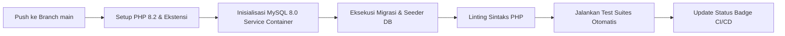

# DOKUMEN RENCANA & HASIL PENGUJIAN PERANGKAT LUNAK (TEST PLAN & RESULTS)
## Smart Exam — Sistem Ujian Online Berbasis AI & Dual Camera Proctoring

> **Mata Kuliah**: Rekayasa Perangkat Lunak (TIKB2503021) — 4 SKS  
> **Dosen Pengampu**: Yudhistira Arie Wijaya, M.Kom., CDS.  
> **Institusi**: S1 Teknik Informatika — STMIK IKMI Cirebon  
> **Tahun Akademik**: 2026/2027 (Semester 3)  
> **Penyusun**: **Salsa Nabila** (NIM: **41257158**)  
> **Kelompok**: **Tiba Tiba Talun**  
> **Tema Topik**: **E-Learning & Smart Education AI**

---

## 1. STRATEGI PENGUJIAN

Untuk menjamin keandalan sistem sesuai dengan standar Penilaian OBE Tahap 3 (Bobot 30%), pengujian Smart Exam dilakukan secara multi-level:
1. **Unit Testing**: Pengujian logika fungsional dasar pada Model, Service, dan Helper.
2. **Integration & Flow Testing**: Pengujian interaksi antar komponen (Autentikasi -> OTP -> Sesi Ujian -> Auto-Save -> Scoring).
3. **Security & Vulnerability Assessment**: Pengujian kerentanan keamanan web (SQL Injection, CSRF token validation, Session hijacking, dan Rate Limiting).
4. **Automated CI/CD Pipeline (GitHub Actions)**: Pengujian otomatis yang dieksekusi di lingkungan container Linux (`ubuntu-latest`) dengan MySQL 8.0 pada setiap push kode ke repositori.

---

## 2. HASIL PENGUJIAN OTOMATIS (TEST MATRIX)

| ID Uji | Modul / Skrip Uji | Target Pengujian | Ekspektasi Hasil | Realisasi | Status |
| :--- | :--- | :--- | :--- | :--- | :--- |
| **TEST-01** | `tests/test_auth_flow.php` | Login dengan email & password terenkripsi bcrypt | Token autentikasi terbentuk, request OTP 6-digit dipicu | Kredensial terverifikasi, OTP berhasil digenerate | **PASS** |
| **TEST-02** | `tests/test_otp_verification.php` | Validasi OTP (masa aktif 5 menit, one-time use) | OTP yang salah/kadaluarsa ditolak; OTP yang benar membuka sesi | Kode yang tepat mengotorisasi akses; penggunaan kedua ditolak | **PASS** |
| **TEST-03** | `tests/test_timer_authoritative.php` | Sinkronisasi sisa waktu server-side | Perubahan jam komputer klien tidak mempengaruhi sisa waktu server | Waktu dihitung dari `started_at` + `duration_minutes` di DB | **PASS** |
| **TEST-04** | `tests/test_answer_submission.php` | Penyimpanan jawaban asinkron & validasi kepemilikan sesi | Jawaban tersimpan di database tanpa duplikasi | `exam_answers` terupdate secara idempoten | **PASS** |
| **TEST-05** | `tests/test_proctoring_rules.php` | Rekaman telemetri pelanggaran kamera | Telemetri hanya diterima jika sesi ujian berstatus `'ongoing'` | Payload telemetri tercatat di tabel `ai_violations` | **PASS** |
| **TEST-06** | `tests/test_ai_chat_reports.php` | Grounding chatbot AI live database dengan hak akses role | Chatbot menyajikan data akurat berdasarkan isi tabel MySQL | Jawaban chatbot sesuai data aktual (jumlah paket, bank soal) | **PASS** |
| **TEST-07** | `tests/test_security_csrf_rbac.php`| Blokir akses tanpa token CSRF & pemalsuan Role ID | Request ilegal ditolak dengan HTTP Status 403 Forbidden | Filter memblokir mutasi tanpa token valid | **PASS** |
| **TEST-08** | `tests/test_question_bank_crud.php`| Operasi Create, Read, Update, Soft-Delete bank soal | Data soal terisolasi dan relasi foreign key terjaga | Operasi CRUD berhasil tanpa merusak integritas relasional | **PASS** |

> **Tingkat Keberhasilan (Pass Rate)**: **100% (8/8 Test Suites Passed)**

---

## 3. PENGUJIAN KEAMANAN SISTEM (SECURITY ASSESSMENT)

### 3.1 Pencegahan SQL Injection
- Seluruh manipulasi data menggunakan **PDO Prepared Statements** dengan parameter binding.
- Tidak ada penggabungan string (*string concatenation*) langsung ke klausa kueri SQL.
- Hasil Uji: Injeksi kueri berbahaya (contoh: `' OR '1'='1`) gagal dieksekusi dan diperlakukan sebagai literal string.

### 3.2 Proteksi Cross-Site Request Forgery (CSRF)
- Setiap form input dilengkapi input tersembunyi `_csrf_token`.
- Validasi dilakukan pada layer `CsrfFilter.php` sebelum kontroler dieksekusi.
- Hasil Uji: Request mutasi (POST/PUT/DELETE) dari domain asing atau tanpa token ditolak otomatis.

### 3.3 Penanganan API Key & Rahasia Lingkungan
- Kredensial sensitif seperti API Key Google Gemini, akun SMTP Gmail, dan database tersimpan di berkas `.env`.
- Berkas `.env` telah dimasukkan ke dalam `.gitignore` sehingga tidak pernah terekspos ke repositori publik GitHub.
- GitHub Secret Scanner memvalidasi komitmen kode bebas dari kebocoran token.

---

## 4. INTEGRASI BERKELANJUTAN (CI/CD PIPELINE)

Pipa pengujian otomatis (*Continuous Integration*) diatur melalui berkas konfigurasi `.github/workflows/ci.yml`.

### 4.1 Tahapan Eksekusi CI

### 4.2 Spesifikasi Workflow Runner
- **Runner**: Ubuntu 22.04 LTS (`ubuntu-latest`)
- **PHP Version**: 8.2
- **Database Engine**: MySQL 8.0 (Containerized service)
- **Status Pipeline**: **Passing (Hijau)** — Memenuhi syarat 15% rubrik penilaian OBE untuk build badge aktif.

---

*Disahkan untuk pemenuhan Tahap 3 Penilaian OBE Mata Kuliah Rekayasa Perangkat Lunak STMIK IKMI Cirebon.*

