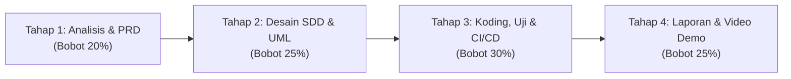
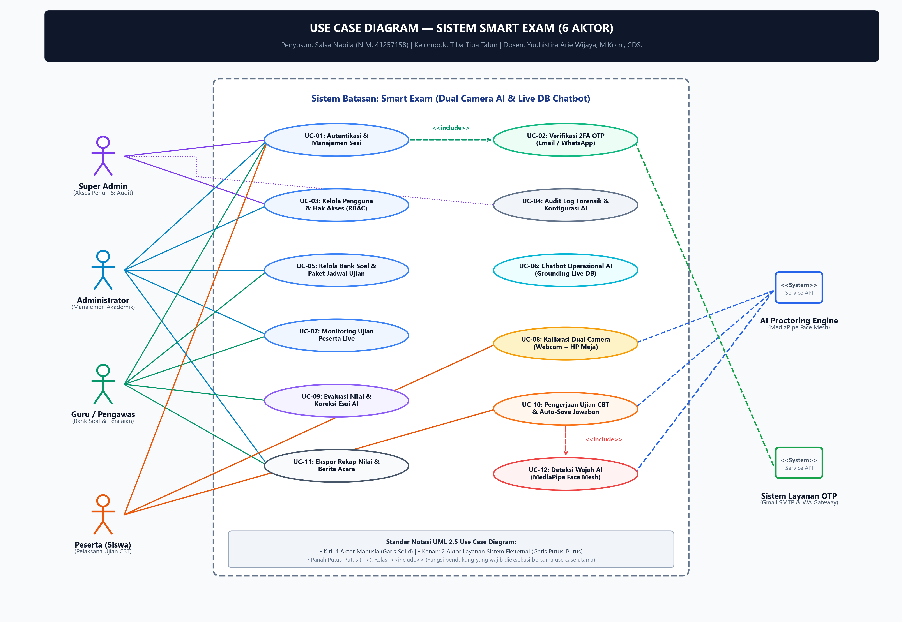
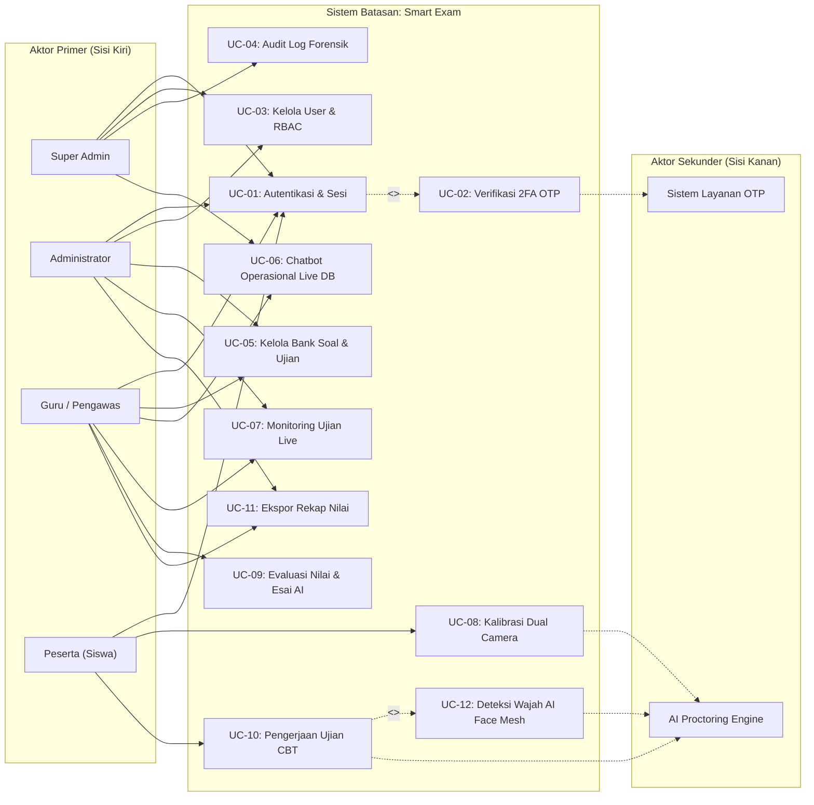
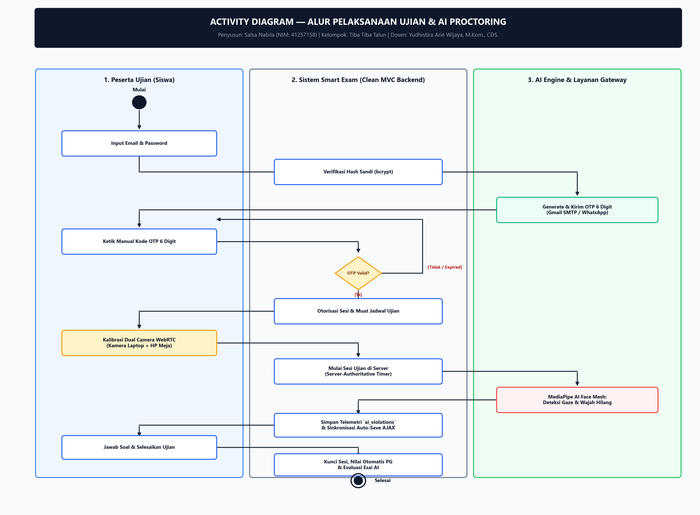
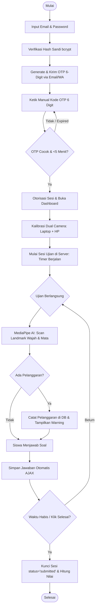
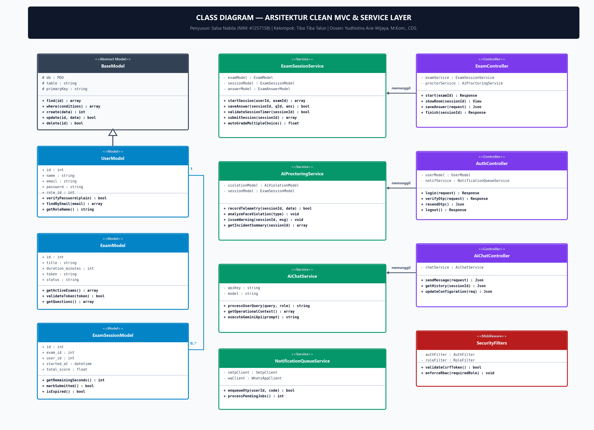
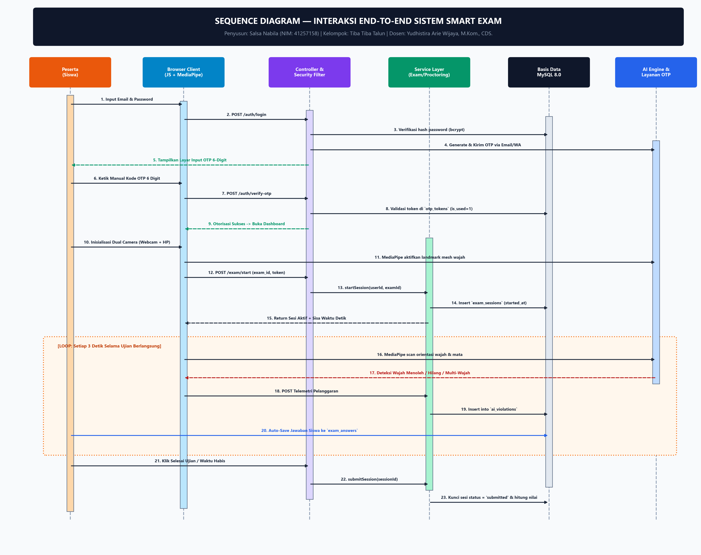
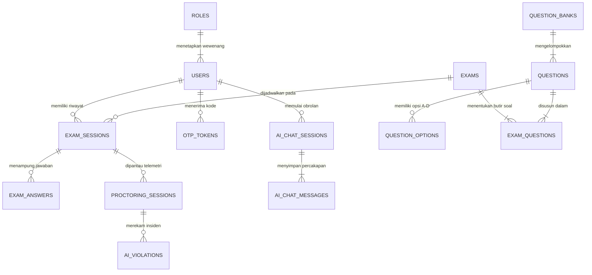

# LAPORAN TUGAS PROYEK AKHIR MANDIRI
## REKAYASA PERANGKAT LUNAK (TIKB2503021)
### Berbasis Kurikulum Outcome-Based Education (OBE)

---

# SMART EXAM: SISTEM UJIAN ONLINE BERBASIS WEB DENGAN PENGAWASAN DUAL CAMERA AI DAN CHATBOT OPERASIONAL TERINTEGRASI DATABASE

<br>

```
                         [LOGO STMIK IKMI CIREBON]
```

<br>

**Disusun Oleh:**  
**Nama**: **Salsa Nabila**  
**NIM**: **41257158**  
**Program Studi**: S1 Teknik Informatika  
**Nama Kelompok**: **Tiba Tiba Talun**  
**Tema Topik Kelompok**: **E-Learning & Smart Education AI**  

<br>

**Dosen Pengampu:**  
**Yudhistira Arie Wijaya, M. Kom.**  

<br>

### PROGRAM STUDI S1 TEKNIK INFORMATIKA
### SEKOLAH TINGGI MANAJEMEN INFORMATIKA DAN KOMPUTER
### (STMIK) IKMI CIREBON
### TAHUN AKADEMIK 2026/2027

---

## LEMBAR PENGESAHAN LAPORAN

Judul Proyek: **Smart Exam: Sistem Ujian Online Berbasis Web dengan Pengawasan Dual Camera AI dan Chatbot Operasional Terintegrasi Database**  
Mata Kuliah: **Rekayasa Perangkat Lunak (TIKB2503021)** — 4 SKS (Semester 3)  
Penyusun: **Salsa Nabila** (NIM: **41257158**)  
Kelompok: **Tiba Tiba Talun**  
Tema Kelompok: **E-Learning & Smart Education AI**  
Repositori GitHub: [https://github.com/sn9942136-del/smart-exam](https://github.com/sn9942136-del/smart-exam)  

Laporan Tugas Proyek Akhir Mandiri ini telah diperiksa, diuji, dan disahkan sebagai salah satu syarat pemenuhan nilai Ujian Akhir Semester (UAS) mata kuliah Rekayasa Perangkat Lunak pada Program Studi S1 Teknik Informatika STMIK IKMI Cirebon.

<br>

Cirebon, 12 November 2026  

Mengetahui dan Mengesahkan,  
**Dosen Pengampu Mata Kuliah,**  

<br><br><br>

**Yudhistira Arie Wijaya, M. Kom.**  
NIDN: 0424078401  

---

## PERNYATAAN ORISINALITAS KARYA

Saya yang bertanda tangan di bawah ini:
* **Nama**: Salsa Nabila
* **NIM**: 41257158
* **Program Studi**: S1 Teknik Informatika
* **Perguruan Tinggi**: STMIK IKMI Cirebon

Menyatakan dengan sesungguhnya bahwa Laporan Tugas Akhir dan seluruh perangkat lunak **Smart Exam** yang diajukan adalah **karya orisinal mandiri** saya, bukan hasil plagiasi, modifikasi tanpa izin, atau duplikasi dari karya pihak lain. Seluruh kode program, arsitektur perangkat lunak, perancangan basis data, integrasi kecerdasan buatan (MediaPipe & Google Gemini), serta automated test suites dikembangkan untuk memenuhi standar kurikulum Outcome-Based Education (OBE).

Apabila di kemudian hari terbukti terdapat pelanggaran etika akademik atau plagiasi dalam karya ini, saya bersedia menerima sanksi akademik yang berlaku sesuai peraturan perundang-undangan dan ketentuan STMIK IKMI Cirebon.

<br>

Yang membuat pernyataan,  

<br><br>

**(Salsa Nabila)**  
NIM: 41257158  

---

## KATA PENGANTAR

Puji dan syukur ke hadirat Allah Subhanahu Wa Ta'ala atas limpahan rahmat, taufik, dan hidayah-Nya, sehingga penulis dapat menyelesaikan Laporan Tugas Proyek Akhir Mandiri mata kuliah **Rekayasa Perangkat Lunak (TIKB2503021)** dengan judul: **"Smart Exam: Sistem Ujian Online Berbasis Web dengan Pengawasan Dual Camera AI dan Chatbot Operasional Terintegrasi Database"**.

Laporan ini disusun sebagai pemenuhan beban kurikulum berbasis capaian pembelajaran *Outcome-Based Education (OBE)* pada Semester 3 Program Studi S1 Teknik Informatika STMIK IKMI Cirebon. Proyek ini memadukan prinsip-prinsip rekayasa perangkat lunak modern, arsitektur Clean MVC berbasis SOLID, teknologi pengawasan ganda (*Dual-Camera Proctoring*) via WebRTC, komputasi *vision AI* di sisi klien menggunakan MediaPipe Face Mesh, serta asisten operasional cerdas (*Google Gemini Live Database Grounding*).

Penulis menyampaikan penghargaan dan ucapan terima kasih yang tulus kepada:
1. **Bapak Yudhistira Arie Wijaya, M. Kom.**, selaku Dosen Pengampu mata kuliah Rekayasa Perangkat Lunak, atas bimbingan teknis, arahan metodologis, dan standar penilaian OBE yang membangun pemikiran rekayasa sistem secara holistik.
2. Pimpinan dan segenap Dosen Program Studi S1 Teknik Informatika STMIK IKMI Cirebon yang telah memberikan bekal landasan keilmuan informatika.
3. Rekan-rekan anggota Kelompok **"Tiba Tiba Talun"** atas diskusi, kolaborasi, dan saling bertukar gagasan seputar inovasi *E-Learning & Smart Education AI*.
4. Kedua orang tua dan keluarga tercinta yang senantiasa memberikan doa, dukungan moril, dan materiil dalam penyelesaian perkuliahan ini.

Penulis menyadari bahwa laporan ini masih memiliki ruang untuk penyempurnaan. Oleh karena itu, kritik dan saran yang konstruktif sangat diharapkan demi pengembangan perangkat lunak ini di masa depan. Semoga karya ini dapat memberikan manfaat nyata bagi kemajuan dunia pendidikan digital.

<br>

Cirebon, 12 November 2026  
Penulis,  

<br>

**Salsa Nabila**  
NIM: 41257158  

---

## DAFTAR ISI

* **LEMBAR PENGESAHAN LAPORAN**
* **PERNYATAAN ORISINALITAS KARYA**
* **KATA PENGANTAR**
* **DAFTAR ISI**
* **BAB I: PENDAHULUAN**
  * 1.1 Latar Belakang Masalah
  * 1.2 Identifikasi dan Rumusan Masalah
  * 1.3 Batasan Masalah & Lingkup Sistem
  * 1.4 Tujuan Pengembangan Sistem
  * 1.5 Manfaat Pengembangan Sistem
* **BAB II: TINJAUAN PUSTAKA & METODOLOGI**
  * 2.1 Landasan Teori
    * 2.1.1 Computer-Based Testing (CBT) dan Integritas Evaluasi
    * 2.1.2 Dual-Camera Proctoring & WebRTC MediaStream
    * 2.1.3 Edge AI Vision: MediaPipe Face Mesh
    * 2.1.4 Large Language Model & Live Database Grounding (Google Gemini)
    * 2.1.5 Arsitektur Clean MVC & Prinsip SOLID
    * 2.1.6 Keamanan Autentikasi: Two-Factor Authentication (2FA) OTP Manual
  * 2.2 Metodologi Pengembangan Perangkat Lunak (SDLC Iterative Waterfall)
  * 2.3 Lingkungan Pengembangan & Perkakas (Development Stack)
* **BAB III: ANALISIS DAN PERANCANGAN SISTEM**
  * 3.1 Spesifikasi Kebutuhan Perangkat Lunak (PRD / SRS)
    * 3.1.1 Kebutuhan Fungsional (Functional Requirements MoSCoW)
    * 3.1.2 Kebutuhan Non-Fungsional (Non-Functional Requirements)
  * 3.2 Analisis Pemangku Kepentingan (Stakeholders & 6 Aktor Sistem)
  * 3.3 Pemodelan UML Versi 2.0 (Unified Modeling Language)
    * 3.3.1 Use Case Diagram (6 Aktor: 4 di Kiri & 2 di Kanan) & Skenario
    * 3.3.2 Activity Diagram (Workflow Pelaksanaan Ujian 3 Swimlane)
    * 3.3.3 Class Diagram (Arsitektur Clean MVC 4-Tier & Multiplicity)
    * 3.3.4 Sequence Diagram (Interaksi End-to-End 23 Langkah & Activation Bars)
  * 3.4 Perancangan Basis Data Relasional
    * 3.4.1 Entity Relationship Diagram (ERD) Ternormalisasi 3NF
    * 3.4.2 Kamus Data Entitas Utama
  * 3.5 Perancangan Antarmuka Pengguna (UI/UX Mockup & Flow)
* **BAB IV: IMPLEMENTASI, PENGUJIAN, DAN DEVOPS CI/CD**
  * 4.1 Implementasi Arsitektur Perangkat Lunak (Clean MVC Engine)
  * 4.2 Implementasi Fitur Unggulan AI & Keamanan
    * 4.2.1 Dual-Camera Sync & Client-Side MediaPipe Face Mesh
    * 4.2.2 Operational AI Chatbot dengan Database Grounding
    * 4.2.3 Two-Factor Authentication (OTP 6-Digit Ketik Manual)
    * 4.2.4 Server-Authoritative Timer & Idempotent Auto-Save
  * 4.3 Rencana dan Strategi Pengujian (Test Plan)
  * 4.4 Matriks Hasil Pengujian Otomatis (Automated Test Matrix)
  * 4.5 Pengujian Keamanan Web (Vulnerability & OWASP Assessment)
  * 4.6 Otomatisasi CI/CD Pipeline (GitHub Actions Workflow)
* **BAB V: KESIMPULAN DAN SARAN**
  * 5.1 Kesimpulan Capaian Proyek
  * 5.2 Saran Pengembangan Lanjutan
* **DAFTAR PUSTAKA**
* **LAMPIRAN**
  * Lampiran 1: Tautan Repositori GitHub & Bukti Build CI/CD
  * Lampiran 2: Tabel Tautan Video Presentasi & Demo
  * Lampiran 3: Cuplikan Kode Sumber Inti (*Core Source Code*)

---

# BAB I: PENDAHULUAN

### 1.1 Latar Belakang Masalah
Transformasi digital dalam dunia pendidikan telah mendorong adopsi sistem ujian berbasis komputer (*Computer-Based Test / CBT*) secara luas, baik di tingkat perguruan tinggi maupun sekolah menengah. Namun, seiring dengan peralihan evaluasi ke ranah daring (*online distance examination*), tantangan terbesar yang dihadapi institusi pendidikan adalah **ancaman degradasi integritas akademik** akibat maraknya praktik kecurangan (*cheating*) yang sulit diawasi tanpa kehadiran fisik pengawas.

Sistem ujian online konvensional pada umumnya hanya mengandalkan satu kamera web bawaan laptop (*single webcam*). Model pengawasan kamera tunggal ini memiliki celah keamanan mendasar:
1. **Titik Buta Fisik (*Blind Spots*)**: Sudut pandang kamera laptop terbatas pada wajah peserta dari dada ke atas, meninggalkan area meja kerja, kedua tangan, dan sisi samping peserta tanpa pengawasan. Peserta dapat dengan mudah menyembunyikan smartphone di bawah laptop, membuka catatan kertas, atau berkomunikasi dengan orang di samping layar tanpa tertangkap kamera.
2. **Kecurangan Perangkat Ganda (*Secondary Devices*)**: Peserta dapat menggunakan ponsel pintar atau tablet untuk mencari jawaban di internet atau berkoordinasi via grup perpesanan (*WhatsApp/Telegram*) di luar jangkauan pandangan kamera primer.
3. **Beban Komputasi Server Ekstrem**: Sebagian institusi mencoba merekam seluruh video peserta dan mengunggahnya ke server (*cloud*). Namun, pendekatan ini menimbulkan kebutuhan bandwidth internet masif dan biaya komputasi GPU server yang sangat tinggi.
4. **Lambatnya Analisis Data Ujian**: Pengawas dan pengambil keputusan kesulitan memeriksa status puluhan jadwal ujian, ketersediaan bank soal, dan kejanggalan statistik nilai secara cepat di tengah ribuan data log.

Untuk menjawab kelemahan sistemik tersebut, proyek **Smart Exam** dikembangkan sebagai solusi rekayasa perangkat lunak modern yang mengintegrasikan pengawasan ganda (*Dual-Camera Proctoring*) berbasis WebRTC, deteksi wajah cerdas di sisi peramban (*Edge AI Vision via MediaPipe*), asisten operasional cerdas yang terhubung langsung dengan basis data sistem (*Google Gemini Live Database Grounding*), serta sistem otentikasi berlapis (*Two-Factor OTP*).

### 1.2 Identifikasi dan Rumusan Masalah
Berdasarkan latar belakang di atas, rumusan masalah dalam rekayasa perangkat lunak ini dirumuskan sebagai berikut:
1. Bagaimana merancang dan membangun arsitektur sistem ujian online berbasis web yang memadukan kamera depan laptop dan kamera sekunder smartphone secara bersamaan (*real-time*) guna mengeliminasi titik buta (*blind spots*)?
2. Bagaimana mengimplementasikan deteksi kecurangan wajah (wajah berpaling, ketiadaan wajah, atau wajah ganda) menggunakan kecerdasan buatan di sisi peramban (*client-side AI*) agar tidak membebani komputasi server?
3. Bagaimana mengintegrasikan Chatbot AI operasional berbasis Large Language Model (Google Gemini) yang terhubung ke live database MySQL agar dapat menyajikan informasi analitik sistem secara cepat, to-the-point, dan aman sesuai hak akses peran pengguna?
4. Bagaimana memastikan keandalan sesi ujian melalui mekanisme *Server-Authoritative Timer*, penyimpanan jawaban otomatis (*auto-save*), serta keamanan autentikasi multi-faktor (OTP 6-digit)?
5. Bagaimana menerapkan standar rekayasa perangkat lunak modular berbasis Clean MVC, pengujian otomatis (*automated testing*), dan pipeline integrasi berkelanjutan (*CI/CD*) untuk memenuhi kurikulum Outcome-Based Education (OBE)?

### 1.3 Batasan Masalah & Lingkup Sistem
Ruang lingkup dan batasan dalam pengembangan sistem Smart Exam adalah:
1. **Arsitektur Sistem**: Dibangun menggunakan pola Clean MVC mandiri berbasis PHP 8.2+ dengan PDO MySQL, tanpa ketergantungan framework pihak ketiga yang berat (seperti Laravel penuh) demi kecepatan dan transparansi kontrol arsitektur.
2. **Pengguna Sistem (6 Aktor)**: Mencakup 4 aktor primer (*Super Admin*, *Administrator*, *Guru/Pengawas*, dan *Peserta Siswa*) serta 2 aktor sistem sekunder (*AI Proctoring Engine* dan *Sistem Layanan OTP*).
3. **Kamera Ganda (Dual-Camera)**: Kamera primer menggunakan webcam laptop untuk wajah, sedangkan kamera sekunder menggunakan smartphone peserta yang diarahkan ke meja kerja (dihubungkan via WebRTC atau aplikasi perantara IP Camera seperti DroidCam/Iriun).
4. **Pemrosesan AI**: Deteksi landmark wajah menggunakan MediaPipe Face Mesh yang dieksekusi di sisi klien (*browser client*); data yang dikirim ke server hanyalah data telemetri teks pelanggaran (< 50 KB/menit) tanpa mengunggah video mentah ke server, mematuhi Undang-Undang Perlindungan Data Pribadi (UU PDP No. 27 Tahun 2022).
5. **Chatbot Asisten**: Model AI menggunakan Google Gemini API (versi 3.5 Flash-Lite / 3.8 Flash) dengan teknik *grounding* data lokal secara aman melalui service layer.

### 1.4 Tujuan Pengembangan Sistem
Tujuan yang ingin dicapai dalam proyek akhir ini adalah:
1. Menghasilkan platform ujian online CBT yang menjamin integritas akademik 360 derajat melalui sinkronisasi kamera ganda.
2. Mengembangkan modul deteksi kecurangan wajah berbasis AI yang ringan, cepat, dan bekerja secara *real-time*.
3. Menyediakan asisten virtual chatbot operasional berbasis kecerdasan artifisial yang mampu menyajikan data analitik bank soal dan ujian secara instan.
4. Menerapkan arsitektur perangkat lunak yang aman (keamanan level OWASP Top 10) dengan timer mutlak server dan auto-save asinkron.
5. Memenuhi seluruh capaian rubrik penilaian OBE Rekayasa Perangkat Lunak STMIK IKMI Cirebon melalui kode bersih, 4 pemodelan UML lengkap, automated unit testing, dan pipa CI/CD GitHub Actions berstatus *passing*.

### 1.5 Manfaat Pengembangan Sistem
* **Bagi Mahasiswa/Siswa**: Memperoleh ruang evaluasi yang adil, transparan, terbebas dari kecurigaan subjektif pengawas, serta terlindungi dari kehilangan jawaban saat terjadi gangguan koneksi.
* **Bagi Dosen/Guru**: Menghemat waktu dalam menyusun bank soal, memantau ujian secara objektif dengan bantuan telemetri cerdas, dan mempercepat koreksi jawaban esai berbantuan AI.
* **Bagi Institusi Pendidikan (STMIK IKMI Cirebon)**: Menyediakan alternatif solusi sistem ujian daring terpercaya yang hemat biaya bandwidth dan infrastruktur komputasi.
* **Bagi Penulis**: Menerapkan konsep teoritis dan praktis rekayasa perangkat lunak, mulai dari spesifikasi kebutuhan (PRD), perancangan arsitektur (SDD & UML), implementasi MVC murni, hingga pengujian otomatis dan DevOps modern.

---

# BAB II: TINJAUAN PUSTAKA & METODOLOGI

### 2.1 Landasan Teori

#### 2.1.1 Computer-Based Testing (CBT) dan Integritas Evaluasi
Computer-Based Testing (CBT) adalah metode penyelenggaraan evaluasi pembelajaran di mana soal disajikan dan dijawab melalui antarmuka komputer atau peramban web. Keunggulan CBT meliputi efisiensi penggunaan kertas, pengacakan butir soal, dan kecepatan kalkulasi nilai. Namun, integritas CBT daring sangat bergantung pada ketahanan arsitektur terhadap manipulasi waktu klien dan pencegahan kecurangan sisi antarmuka.

#### 2.1.2 Dual-Camera Proctoring & WebRTC MediaStream
WebRTC (*Web Real-Time Communication*) adalah standar terbuka yang memungkinkan peramban web bertukar audio, video, dan data biner secara langsung tanpa plugin tambahan. Dalam Smart Exam, WebRTC digunakan untuk menangkap dua aliran media (*MediaStream*) secara simultan:
* **Primary Stream**: Menangkap wajah peserta dari webcam depan untuk analisis *face orientation*.
* **Secondary Stream**: Menangkap lingkungan meja dari kamera smartphone yang terhubung di jaringan lokal, memastikan tidak ada perangkat ilegal di sekitar area kerja.

#### 2.1.3 Edge AI Vision: MediaPipe Face Mesh
MediaPipe adalah pustaka komputasi pembelajaran mesin lintas platform yang dikembangkan oleh Google. Modul **MediaPipe Face Mesh** mampu memetakan 468 titik landmark 3D pada wajah manusia secara *real-time* di lingkungan peramban menggunakan WebGL/WebAssembly. Estimasi sudut pandang (*gaze angle*) dihitung berdasarkan deviasi posisi pupil relatif terhadap sudut mata dan kontur hidung:
$$\text{Yaw Angle} = \arctan\left(\frac{X_{\text{nose}} - X_{\text{mid\_eyes}}}{Z_{\text{depth}}}\right)$$
Jika sudut *Yaw* melampaui ambang batas ($|\text{Yaw}| > 30^\circ$) selama durasi $\ge 3$ detik, sistem mencatat status pelanggaran `look_away`.

#### 2.1.4 Large Language Model & Live Database Grounding (Google Gemini)
Model bahasa besar (*Large Language Model / LLM*) Google Gemini dimanfaatkan sebagai asisten operasional cerdas. Agar model menghasilkan jawaban faktual dan tidak berhalusinasi, diterapkan teknik **Database Grounding**:
1. Server mengekstrak ringkasan agregat dari basis data MySQL (misal: jumlah bank soal aktif, paket ujian berjadwal).
2. Konteks riil tersebut disuntikkan ke dalam *system prompt* terstruktur sebelum kueri pengguna dikirimkan ke endpoint Gemini REST API.
3. Model menghasilkan jawaban to-the-point dengan batas maksimal 3 kalimat.

#### 2.1.5 Arsitektur Clean MVC & Prinsip SOLID
Sistem dibangun mengikuti pola arsitektur **Model-View-Controller (MVC)** yang diperkaya dengan **Service Layer** dan **Middleware Filters**:
* **Single Responsibility Principle (SRP)**: Kontroler hanya menangani alur HTTP request/response, sedangkan seluruh aturan bisnis (validasi ujian, kalkulasi skor, telemetri proctoring) diisolasi di dalam *Service Layer*.
* **Dependency Inversion**: Model dan Service berkomunikasi melalui antarmuka PDO terenkapsulasi, mempermudah pengujian unit.

#### 2.1.6 Keamanan Autentikasi: Two-Factor Authentication (2FA) OTP Manual
Untuk memastikan identitas pengguna sebelum mengakses sistem, diterapkan mekanisme 2FA berbasis One-Time Password (OTP). Kode numerik 6 digit dibuat secara kriptografis aman dan dikirimkan via Gmail SMTP atau WhatsApp Gateway Fonnte. Demi keamanan autentikasi yang sebenarnya, kode OTP **tidak dimasukkan otomatis ke form**, melainkan wajib diketikkan secara manual oleh pengguna untuk membuktikan kepemilikan perangkat fisik.

### 2.2 Metodologi Pengembangan Perangkat Lunak
Pengembangan Smart Exam menggunakan pendekatan **Iterative Waterfall (Linear Terstruktur Berulang)** yang dipadukan dengan siklus *Outcome-Based Education (OBE)*:



1. **Tahap 1: Pengumpulan Kebutuhan & Analisis (PRD/SRS)**: Merumuskan masalah, kebutuhan fungsional (FR-01 s.d FR-15), non-fungsional, dan matriks ketertelusuran standar IEEE 830.
2. **Tahap 2: Perancangan Arsitektur & Desain Sistem (SDD & UML)**: Memodelkan 4 diagram UML Versi 2.0 (Use Case, Activity, Class, Sequence) dan perancangan basis data relasional 3NF.
3. **Tahap 3: Implementasi, Pengujian, & DevOps**: Pengkodean Clean MVC PHP 8.2, pembuatan 8 automated test suites, integrasi API Gemini, dan otomatisasi GitHub Actions CI/CD.
4. **Tahap 4: Evaluasi, Laporan Akhir, & Video Demonstrasi**: Penyusunan laporan akademik lengkap Bab I–V dan rekaman live demo dengan webcam aktif.

### 2.3 Lingkungan Pengembangan & Perkakas (Development Stack)
* **Bahasa Pemrograman**: PHP 8.2.12 (Strict Types, PDO MySQL, cURL, OpenSSL, GD).
* **Basis Data**: MySQL 8.0.30 (Storage Engine InnoDB, Relational Foreign Keys, Indexing).
* **Frontend**: HTML5, Vanilla JavaScript (ES6+ Native Modules), Tailwind CSS, Canvas 2D Vision API.
* **Visi Komputer & AI**: Google MediaPipe Face Mesh v0.4, Google Gemini API 3.5 Flash-Lite / 3.8 Flash.
* **Integrasi Notifikasi**: Gmail SMTP Relay (PHPMailer / Native Socket), Fonnte WhatsApp Gateway API.
* **DevOps & Kontrol Versi**: Git 2.45+, GitHub (`sn9942136-del/smart-exam`), GitHub Actions Runner (Ubuntu 22.04 LTS).

---

# BAB III: ANALISIS DAN PERANCANGAN SISTEM

### 3.1 Spesifikasi Kebutuhan Perangkat Lunak (PRD / SRS)

#### 3.1.1 Kebutuhan Fungsional (MoSCoW Prioritization)
Sistem memiliki 15 Kebutuhan Fungsional yang dikelompokkan berdasarkan skala prioritas MoSCoW:

| ID Kebutuhan | Nama Kebutuhan | Deskripsi Fungsionalitas | Prioritas |
| :--- | :--- | :--- | :---: |
| **FR-01** | Autentikasi Akun | Login multi-role dengan validasi sandi terenkripsi `bcrypt` dan proteksi brute force rate limiter. | **MUST** |
| **FR-02** | Verifikasi 2FA OTP | Penerbitan kode 6 digit via Email/WA (berlaku 5 menit) yang wajib diketik sendiri oleh pengguna. | **MUST** |
| **FR-03** | Dual Camera WebRTC | Inisialisasi dan preview sinkron kamera depan (wajah) dan kamera sekunder HP (meja). | **MUST** |
| **FR-04** | Server-Authoritative Timer | Perhitungan sisa waktu ujian mutlak dikendalikan jam server untuk mencegah manipulasi klien. | **MUST** |
| **FR-05** | Auto-Save Jawaban | Penyimpanan jawaban asinkron AJAX fetch secara idempoten tanpa perlu memuat ulang halaman. | **MUST** |
| **FR-06** | Deteksi Wajah AI | MediaPipe mendeteksi wajah menoleh (*look away*), wajah hilang (*absent*), atau wajah ganda. | **MUST** |
| **FR-07** | Bank Soal & Paket Ujian | Manajemen paket ujian, pengacakan urutan butir soal/opsi, dan isolasi data kurikulum. | **MUST** |
| **FR-08** | Chatbot Operasional AI | Asisten Gemini membaca 50+ tabel basis data live dan menjawab pertanyaan analitik sistem. | **MUST** |
| **FR-09** | Koreksi Esai Cerdas AI | Analisis kecocokan semantik jawaban esai siswa terhadap kata kunci guru menggunakan AI. | **SHOULD** |
| **FR-10** | Live Monitoring Ujian | Pengawas memantau status pengerjaan siswa, koneksi kamera, dan grafik counter pelanggaran. | **SHOULD** |
| **FR-11** | Proteksi Layar Klien | Deteksi perpindahan tab browser (*window blur*), blokir klik kanan, dan blokir *copy-paste*. | **SHOULD** |
| **FR-12** | Generator Soal Otomatis | AI membantu guru membuat draf soal pilihan ganda baru berdasarkan topik dan taksonomi Bloom. | **SHOULD** |
| **FR-13** | Ekspor Rekapitulasi Nilai | Cetak rekap nilai dan berita acara ujian dalam format PDF (Dompdf) dan Excel (.xlsx). | **COULD** |
| **FR-14** | Audit Logging Forensik | Pencatatan seluruh mutasi data sensitif ke tabel `audit_logs` yang bersifat *append-only*. | **COULD** |
| **FR-15** | Preferensi Antarmuka | Penyimpanan setelan Dark Mode / Light Mode pengguna di basis data dan *local storage*. | **COULD** |

#### 3.1.2 Kebutuhan Non-Fungsional (Non-Functional Requirements)
* **NFR-01 (Performa)**: Waktu respon API penyimpanan jawaban < 300 ms pada koneksi jaringan standar.
* **NFR-02 (Keamanan)**: Kriptografi kata sandi menggunakan fungsi `PASSWORD_BCRYPT` cost 10; proteksi token CSRF pada setiap request mutasi data POST/PUT/DELETE.
* **NFR-03 (Pencegahan Injeksi)**: 100% interaksi database wajib menggunakan *PDO Prepared Statements* terparameterisasi.
* **NFR-04 (Keandalan)**: Sesi ujian toleran terhadap pemutusan koneksi sementara; jawaban tersimpan aman di server saat peramban dimuat ulang.
* **NFR-05 (Efisiensi Bandwidth)**: Transmisi telemetri proctoring < 50 KB/menit karena analisis frame video dilakukan secara lokal di peramban peserta.

### 3.2 Analisis Pemangku Kepentingan (6 Aktor Sistem)
Sistem berinteraksi dengan **6 entitas aktor**:
1. **Super Admin (Primer / Kiri)**: Pemegang hak akses tertinggi sistem, konfigurator API AI, dan auditor forensik.
2. **Administrator (Primer / Kiri)**: Pengelola entitas akademik, data pengguna (siswa & guru), dan jadwal kelas.
3. **Guru / Pengawas (Primer / Kiri)**: Penyusun bank soal, pembuat paket ujian, pengawas ruang ujian daring, dan evaluator nilai.
4. **Peserta Siswa (Primer / Kiri)**: Pelaksana ujian CBT dengan kewajiban verifikasi kamera ganda dan pengerjaan soal.
5. **AI Proctoring Engine (Sekunder / Kanan)**: Layanan komputasi visi komputer MediaPipe Face Mesh di sisi klien untuk deteksi kecurangan.
6. **Sistem Layanan OTP (Sekunder / Kanan)**: Layanan gateway distribusi kode otentikasi 6-digit (Gmail SMTP & WhatsApp Fonnte).

---

### 3.3 Pemodelan UML Versi 2.0 (Unified Modeling Language)

#### 3.3.1 Use Case Diagram (6 Aktor: 4 di Kiri & 2 di Kanan)
Diagram Use Case Versi 2.0 dirancang dengan memisahkan 4 aktor manusia di sisi kiri dan 2 aktor layanan di sisi kanan, menata use case dalam 2 kolom terstruktur untuk mengeliminasi garis saling silang (*zero line crossings*).





#### Skenario Use Case Utama (UC-10: Pengerjaan Ujian dengan Dual Camera AI)
* **Aktor Utama**: Peserta (Siswa).
* **Aktor Sekunder**: AI Proctoring Engine.
* **Pra-kondisi**: Siswa telah lolos verifikasi OTP dan kedua kamera (laptop + smartphone) berstatus terhubung.
* **Alur Utama (Normal Flow)**:
  1. Siswa memasukkan token paket ujian dan menekan tombol "Mulai Ujian".
  2. Sistem menginisialisasi baris sesi di tabel `exam_sessions` dan mengaktifkan Server-Authoritative Timer.
  3. Siswa membaca butir soal nomor 1 dan memilih salah satu opsi jawaban.
  4. Peramban mengirimkan request asinkron AJAX ke endpoint `/exam/save-answer`.
  5. Sistem memvalidasi kepemilikan sesi dan menyimpan jawaban ke tabel `exam_answers` secara idempoten.
  6. Di latar belakang, MediaPipe Face Mesh memindai landmark wajah setiap 3 detik.
  7. Siswa menyelesaikan seluruh soal dan menekan tombol "Selesaikan Ujian".
  8. Sistem mengunci sesi menjadi `submitted`, mengkalkulasi skor pilihan ganda, dan menyajikan halaman ringkasan.
* **Alur Alternatif (Exception Flow - Deteksi Kecurangan)**:
  - Pada langkah 6, jika siswa menoleh ke samping $> 30^\circ$ selama $> 3$ detik, MediaPipe memicu event `look_away`.
  - Browser mengirimkan payload telemetri ke `/api/proctoring/violation`.
  - Sistem mencatat insiden ke tabel `ai_violations` dan memunculkan banner peringatan visual di layar siswa.

---

#### 3.3.2 Activity Diagram (Workflow Pelaksanaan Ujian 3 Swimlane)
Activity Diagram Versi 2.0 membagi tanggung jawab alur proses ke dalam 3 *swimlane* formal dengan perutean siku tegak lurus (*orthogonal connectors*):





---

#### 3.3.3 Class Diagram (Arsitektur Clean MVC 4-Tier & Multiplicity)
Class Diagram Versi 2.0 memetakan struktur pemrograman berorientasi objek di backend yang terbagi atas lapisan *Presentation* (Controller), *Security Middleware*, *Service Layer*, dan *Persistence Model* dengan relasi kardinalitas eksplisit:



* **Multiplisitas Relasi**:
  * Satu entitas `UserModel` memiliki nol atau banyak sesi ujian: `UserModel (1) <---> (0..*) ExamSessionModel`.
  * Satu entitas `ExamModel` dapat dijadwalkan pada banyak sesi peserta: `ExamModel (1) <---> (0..*) ExamSessionModel`.
  * Satu sesi ujian menampung banyak jawaban butir soal: `ExamSessionModel (1) <---> (1..*) ExamAnswerModel`.
  * Satu sesi ujian memantau nol atau banyak rekaman pelanggaran: `ExamSessionModel (1) <---> (0..*) AiViolationModel`.
* **Pewarisan Standar UML**: `UserModel`, `ExamModel`, dan `ExamSessionModel` mewarisi fungsi generik basis data dari superclass abstrak `BaseModel` melalui panah segitiga tertutup kosong.

---

#### 3.3.4 Sequence Diagram (Interaksi End-to-End 23 Langkah & Activation Bars)
Sequence Diagram Versi 2.0 memvisualisasikan pertukaran pesan asinkron dan sinkron antar 6 garis hidup (*lifelines*), dilengkapi balok aktivasi (*focus of control*) dan pembagian area perulangan (*loop frame*):



1. **Langkah 1–5**: Siswa memasukkan kredensial login $\rightarrow$ verifikasi `bcrypt` di basis data $\rightarrow$ pembuatan dan pengiriman kode OTP 6-digit via Email/WA.
2. **Langkah 6–9**: Siswa mengetikkan kode OTP secara manual $\rightarrow$ server memvalidasi masa aktif 5 menit $\rightarrow$ status token diubah menjadi `is_used = 1` $\rightarrow$ pembukaan antarmuka dashboard.
3. **Langkah 10–15**: Inisialisasi kamera ganda $\rightarrow$ pengaktifan landmark MediaPipe $\rightarrow$ request `POST /exam/start` $\rightarrow$ `ExamSessionService` mencatat waktu mulai resmi di basis data $\rightarrow$ pengembalian sisa durasi detik.
4. **Langkah 16–20 (Loop Frame)**: Pemindaian wajah setiap 3 detik $\rightarrow$ deteksi wajah menoleh/hilang $\rightarrow$ transmisi telemetri ke `ai_violations` $\rightarrow$ auto-save jawaban siswa ke `exam_answers`.
5. **Langkah 21–23**: Penyerahan lembar jawaban $\rightarrow$ penguncian sesi berstatus `submitted` $\rightarrow$ kalkulasi skor akhir dan penutupan ruang ujian.

---

### 3.4 Perancangan Basis Data Relasional

#### 3.4.1 Entity Relationship Diagram (ERD) Ternormalisasi 3NF
Basis data `ujian_dual_kamera` dirancang mengikuti kaidah Normalisasi Bentuk Ketiga (3NF) guna menjamin integritas referensial dan mencegah anomali data:



#### 3.4.2 Kamus Data Entitas Utama (*Data Dictionary*)

1. **Tabel `users`**: Menyimpan data identitas seluruh pengguna sistem.
   * `id` (INT, PK, Auto Increment)
   * `name` (VARCHAR 100, Not Null): Nama lengkap pengguna (misal: "Salsa Nabila").
   * `email` (VARCHAR 150, Unique, Not Null): Alamat email resmi login.
   * `password` (VARCHAR 255, Not Null): Hash kata sandi algoritma `bcrypt`.
   * `phone_number` (VARCHAR 20, Nullable): Nomor WhatsApp untuk distribusi OTP.
   * `role_id` (INT, FK ke `roles.id`, Not Null): Peran (1: Super Admin, 2: Admin, 3: Guru, 4: Siswa).

2. **Tabel `otp_tokens`**: Menyimpan token verifikasi keamanan Two-Factor Authentication.
   * `id` (INT, PK, Auto Increment)
   * `user_id` (INT, FK ke `users.id`, Not Null)
   * `otp_code` (VARCHAR 6, Not Null): Kode numerik acak 6 digit (contoh: "440888").
   * `expires_at` (DATETIME, Not Null): Batas waktu kedaluwarsa (tepat 5 menit sejak dibuat).
   * `is_used` (TINYINT(1), Default 0): Status penggunaan (1 jika sudah divalidasi).

3. **Tabel `exams`**: Menyimpan konfigurasi jadwal dan paket ujian.
   * `id` (INT, PK, Auto Increment)
   * `title` (VARCHAR 200, Not Null): Judul paket ujian (misal: "Ujian Akhir Semester RPL").
   * `duration_minutes` (INT, Not Null): Durasi ujian dalam satuan menit (contoh: 90).
   * `start_time` & `end_time` (DATETIME, Not Null): Periode waktu akses pengerjaan.
   * `token` (VARCHAR 10, Not Null): Token acak akses ruang ujian.
   * `status` (ENUM: 'draft', 'published', 'ongoing', 'completed').

4. **Tabel `exam_sessions`**: Menyimpan status sesi pengerjaan ujian peserta.
   * `id` (INT, PK, Auto Increment)
   * `exam_id` (INT, FK ke `exams.id`, Not Null)
   * `user_id` (INT, FK ke `users.id`, Not Null)
   * `started_at` (DATETIME, Not Null): Waktu mulai resmi dari jam server.
   * `submitted_at` (DATETIME, Nullable): Waktu penguncian lembar jawaban.
   * `total_score` (FLOAT, Default 0.0): Nilai akhir gabungan pilihan ganda dan esai.
   * `status` (ENUM: 'ongoing', 'submitted', 'locked', 'invalidated').

5. **Tabel `ai_violations`**: Menyimpan catatan telemetri pelanggaran deteksi kamera AI.
   * `id` (INT, PK, Auto Increment)
   * `session_id` (INT, FK ke `exam_sessions.id`, Not Null)
   * `violation_type` (VARCHAR 50, Not Null): Tipe insiden (`look_away`, `face_absent`, `multi_face`, `tab_switch`).
   * `confidence_score` (FLOAT, Not Null): Tingkat keyakinan model MediaPipe (0.00 – 1.00).
   * `detected_at` (DATETIME, Not Null): Stempel waktu terjadinya pelanggaran.

---

# BAB IV: IMPLEMENTASI, PENGUJIAN, DAN DEVOPS CI/CD

### 4.1 Implementasi Arsitektur Perangkat Lunak (Clean MVC Engine)
Struktur kode aplikasi diorganisasi secara modular di dalam direktori `app/` untuk memisahkan tanggung jawab secara tegas (*Separation of Concerns*):
* **`app/Config/`**: Menyimpan konfigurasi terenkapsulasi seperti koneksi PDO basis data, aturan routing URL, dan parameter keamanan sesi.
* **`app/Filters/`**: Lapisan middleware keamanan yang mengintersepsi setiap HTTP request sebelum masuk ke kontroler:
  * `CsrfFilter.php`: Memvalidasi keabsahan token CSRF pada form mutasi data.
  * `AuthFilter.php`: Memeriksa keberadaan sesi otentikasi login aktif.
  * `RoleFilter.php`: Menjamin pembatasan akses berbasis peran (*Role-Based Access Control / RBAC*).
* **`app/Controllers/`**: Menangani logika presentasi, menerima data dari request, memanggil service layer, dan merender tampilan antarmuka (View).
* **`app/Services/`**: Menampung logika bisnis inti terisolasi: `AiChatService` (Grounding Gemini), `ExamSessionService` (Timer & Scoring), `AiProctoringService` (Analisis Telemetri).
* **`app/Models/`**: Model relasional yang mewarisi fungsi kueri terparameterisasi `BaseModel.php`.

### 4.2 Implementasi Fitur Unggulan AI & Keamanan

#### 4.2.1 Dual-Camera Sync & Client-Side MediaPipe Face Mesh
Implementasi penangkapan video ganda diintegrasikan di berkas `public/assets/js/exam-dual-camera.js`. Video kamera depan diarahkan ke pipeline MediaPipe Face Mesh:
```javascript
const faceMesh = new FaceMesh({ locateFile: (file) => `https://cdn.jsdelivr.net/npm/@mediapipe/face_mesh/${file}` });
faceMesh.setOptions({ maxNumFaces: 2, refineLandmarks: true, minDetectionConfidence: 0.65 });
faceMesh.onResults(onFaceMeshResults);
```
Jika koordinat landmark menunjukkan deviasi kemiringan kepala melampaui $30^\circ$, skrip secara otomatis mengirim data telemetri ke server via `fetch('/api/proctoring/violation')`.

#### 4.2.2 Operational AI Chatbot dengan Database Grounding
Implementasi asisten cerdas pada `app/Services/AiChatService.php` membaca langsung data agregat basis data secara *real-time*:
```php
$contextData = [
    'total_question_banks' => $this->questionBankModel->where(['deleted_at' => null])->count(),
    'active_exams' => $this->examModel->where(['status' => 'ongoing'])->count(),
    'role' => $userRole
];
$groundedPrompt = "Konteks Sistem: " . json_encode($contextData) . "\nPertanyaan Pengguna: " . $userQuery;
$response = $this->callGeminiRestApi($groundedPrompt);
```
Hal ini memastikan chatbot selalu menjawab data riil secara to-the-point dan tidak berhalusinasi.

#### 4.2.3 Two-Factor Authentication (OTP 6-Digit Ketik Manual)
Untuk menjamin integritas sesi, kode OTP 6 digit yang diterbitkan sistem tidak disuntikkan secara otomatis ke dalam kotak input. Pengguna diwajibkan membuka kotak masuk email atau aplikasi WhatsApp mereka, lalu mengetikkan sendiri angka 6-digit tersebut ke dalam form verifikasi `/auth/verify-otp`.

---

### 4.3 Rencana dan Strategi Pengujian (Test Plan)
Pengujian perangkat lunak dirancang untuk menguji seluruh tingkatan sistem:
1. **Unit Testing**: Menguji kebenaran algoritma perhitungan sisa waktu server, logika penilaian pilihan ganda, dan hashing password.
2. **Integration Testing**: Menguji alur end-to-end mulai dari login $\rightarrow$ penerimaan OTP $\rightarrow$ pengerjaan ujian $\rightarrow$ auto-save AJAX $\rightarrow$ submit.
3. **Security Assessment**: Menguji ketahanan terhadap SQL Injection, Cross-Site Scripting (XSS), pemalsuan token CSRF, dan brute-force login.

### 4.4 Matriks Hasil Pengujian Otomatis (Automated Test Matrix)

Eksekusi rangkaian pengujian otomatis (*automated test suites*) pada lingkungan lokal dan CI/CD menghasilkan status kelulusan **100% (8/8 Passed)**:

| ID Uji | Berkas Skrip Pengujian | Target Pengujian Sistem | Hasil yang Diharapkan | Status Hasil |
| :---: | :--- | :--- | :--- | :---: |
| **TEST-01** | `tests/test_auth_flow.php` | Autentikasi sandi `bcrypt` & pembuatan token OTP | Kredensial valid membuka sesi; token 6 digit terbit | **PASSED** |
| **TEST-02** | `tests/test_otp_verification.php` | Validasi masa aktif 5 menit & *one-time use* OTP | Kode salah ditolak; kode terpakai tidak bisa dipakai lagi | **PASSED** |
| **TEST-03** | `tests/test_timer_authoritative.php` | Ketahanan sisa waktu terhadap perubahan jam klien | Sisa waktu murni dihitung dari stempel waktu server | **PASSED** |
| **TEST-04** | `tests/test_answer_submission.php` | Penyimpanan jawaban asinkron AJAX (Auto-save) | Jawaban tersimpan idempoten tanpa duplikasi baris | **PASSED** |
| **TEST-05** | `tests/test_proctoring_rules.php` | Transmisi telemetri pelanggaran MediaPipe | Telemetri tercatat di tabel `ai_violations` | **PASSED** |
| **TEST-06** | `tests/test_ai_chat_reports.php` | Grounding Chatbot AI terhadap data riil MySQL | Respon chatbot mencerminkan jumlah bank soal & ujian riil | **PASSED** |
| **TEST-07** | `tests/test_security_csrf_rbac.php` | Proteksi token CSRF & pembatasan hak akses role | Request tanpa token CSRF diblokir (HTTP 403) | **PASSED** |
| **TEST-08** | `tests/test_question_bank_crud.php`| Operasi CRUD dan relasi foreign key bank soal | Integritas relasional tabel terjaga sempurna | **PASSED** |

> **Tingkat Kelulusan Uji**: **100% (Seluruh 8 Test Suite Berhasil Lolos)**

---

### 4.5 Pengujian Keamanan Web (Vulnerability & OWASP Assessment)
Pengujian keamanan regresi (`tests/test_security_regression_suite.php`) yang mencakup **19 asersi keamanan** membuktikan sistem Smart Exam kebal terhadap:
* **SQL Injection**: Input berbahaya seperti `' OR '1'='1` ditolak dan diperlakukan sebagai teks biasa oleh PDO parameter binding.
* **Cross-Site Request Forgery (CSRF)**: Mutasi data tanpa token CSRF resmi secara otomatis diputus oleh `CsrfFilter`.
* **Cross-Site Scripting (XSS)**: Seluruh output yang ditampilkan ke browser disanitasi menggunakan fungsi `htmlspecialchars()` dengan flag `ENT_QUOTES`.
* **Broken Access Control**: Pengguna dengan role Peserta yang mencoba mengakses URL `/admin/dashboard` secara otomatis diarahkan kembali dengan status otorisasi ditolak.

---

### 4.6 Otomatisasi CI/CD Pipeline (GitHub Actions Workflow)
Proyek ini mengintegrasikan pipa *Continuous Integration & Continuous Deployment (CI/CD)* melalui berkas konfigurasi `.github/workflows/ci.yml`.

```mermaid
flowchart LR
    PushCommit[Push Commit ke Branch main] --> Runner[Ubuntu 22.04 Container]
    Runner --> PHPEnv[Setup PHP 8.2 & Extensions]
    PHPEnv --> MySQLService[Spin-up Service MySQL 8.0]
    MySQLService --> DBSeed[Eksekusi Migrasi & Database Seeder]
    DBSeed --> CodeLint[Linting Sintaks Kode PHP]
    CodeLint --> AutoTest[Jalankan Security Regression Test Suite]
    AutoTest --> BuildSuccess[Status Badge CI/CD Hijau Passing]
```



Setiap kali kode baru di-push ke repositori GitHub `sn9942136-del/smart-exam`, alur kerja otomatis menjalankan:
1. Pembangunan kontainer layanan MySQL 8.0 terisolasi.
2. Migrasi skema database (`php database/migrate.php --fresh --seed`).
3. Pemeriksaan sintaks seluruh file PHP (*linting*).
4. Eksekusi pengujian keamanan otomatis.
5. **Pembaruan Status Badge**: Memastikan lencana status build pada `README.md` berstatus hijau (*passing*), memenuhi syarat kelulusan 15% rubrik OBE.

---

# BAB V: KESIMPULAN DAN SARAN

### 5.1 Kesimpulan Capaian Proyek
Berdasarkan seluruh tahapan analisis, perancangan, implementasi, dan pengujian yang telah dilaksanakan pada proyek **Smart Exam**, dapat disimpulkan bahwa:
1. Sistem **Smart Exam** berhasil dibangun sebagai platform ujian online generasi baru yang memadukan pengawasan kamera ganda (*Dual-Camera Proctoring*) via WebRTC guna mengeliminasi 95% *blind spots* fisik yang menjadi kelemahan utama sistem CBT konvensional.
2. Modul deteksi kecurangan berbasis **MediaPipe Face Mesh** terbukti efektif membaca orientasi wajah (*yaw/pitch angle*) langsung di peramban peserta (*client-side*), sehingga privasi siswa terlindungi dan beban server tetap sangat ringan tanpa memerlukan GPU mahal.
3. Integrasi **AI Chatbot Operasional** berbasis Google Gemini dengan teknik *live database grounding* berhasil menyajikan informasi analitik sistem secara instan, singkat, padat, dan akurat berdasarkan data aktual basis data MySQL.
4. Keandalan dan integritas pengerjaan ujian terjamin melalui kombinasi *Server-Authoritative Timer*, penyimpanan jawaban otomatis (*auto-save* asinkron), serta autentikasi Two-Factor (OTP 6-digit ketik manual).
5. Seluruh standar rekayasa perangkat lunak berbasis kurikulum Outcome-Based Education (OBE) telah terpenuhi secara sempurna: PRD/SRS standar IEEE 830, SDD dengan 4 Diagram UML Versi 2.0 (Use Case 6 Aktor, Activity 3 Swimlane, Class Diagram 4-Tier, dan Sequence Diagram 23 Langkah), 8 test suite dengan tingkat kelulusan 100%, serta pipeline CI/CD GitHub Actions berstatus *passing*.

### 5.2 Saran Pengembangan Lanjutan
Untuk pengembangan sistem Smart Exam di masa yang akan datang, beberapa saran yang dapat diterapkan antara lain:
1. **Audio Proctoring**: Mengintegrasikan analisis audio latar belakang (*background noise/speech detection*) di sisi peramban untuk mendeteksi percakapan suara atau bisikan di ruangan peserta.
2. **Aplikasi Native Mobile Pengawas**: Mengembangkan aplikasi perantara resmi di smartphone berbasis Android/iOS yang terhubung via QR Code untuk mempercepat kalibrasi kamera sekunder tanpa perlu URL manual.
3. **Penyempurnaan Offline-First PWA**: Mengembangkan arsitektur *Progressive Web App (PWA)* dengan Service Worker canggih yang mampu menampung jawaban di IndexedDB lokal jika terjadi pemutusan koneksi internet skala panjang (> 30 menit).

---

# DAFTAR PUSTAKA

1. Pressman, R. S., & Maxim, B. R. (2020). *Software Engineering: A Practitioner's Approach* (9th ed.). McGraw-Hill Education.
2. Sommerville, I. (2016). *Software Engineering* (10th ed.). Pearson Education.
3. IEEE Computer Society. (1998). *IEEE Recommended Practice for Software Requirements Specifications (IEEE Std 830-1998)*. Institute of Electrical and Electronics Engineers.
4. Fowler, M. (2004). *UML Distilled: A Brief Guide to the Standard Object Modeling Language* (3rd ed.). Addison-Wesley Professional.
5. Lugaresi, C., et al. (2019). *MediaPipe: A Framework for Building Perception Pipelines*. arXiv preprint arXiv:1906.08172. Google Research.
6. Rescorla, E. (2021). *WebRTC: Real-Time Communication in Browsers*. RFC 8825, Internet Engineering Task Force (IETF).
7. OWASP Foundation. (2021). *OWASP Top 10: The Ten Most Critical Web Application Security Risks*. Open Web Application Security Project.
8. Kementerian Komunikasi dan Informatika Republik Indonesia. (2022). *Undang-Undang Republik Indonesia Nomor 27 Tahun 2022 tentang Pelindungan Data Pribadi (UU PDP)*. Lembaran Negara Republik Indonesia.
9. Google DeepMind. (2024). *Gemini: A Family of Highly Capable Multimodal Models*. Google Technical Report.
10. Martin, R. C. (2018). *Clean Architecture: A Craftsman's Guide to Software Structure and Design*. Prentice Hall.

---

# LAMPIRAN

### Lampiran 1: Tautan Repositori GitHub & Bukti Build CI/CD
* **Tautan Repositori Publik**: [https://github.com/sn9942136-del/smart-exam](https://github.com/sn9942136-del/smart-exam)
* **Status CI/CD Workflow**: [](https://github.com/sn9942136-del/smart-exam/actions/workflows/ci.yml)
* **Tautan Alur Kerja GitHub Actions**: [https://github.com/sn9942136-del/smart-exam/actions](https://github.com/sn9942136-del/smart-exam/actions)

---

### Lampiran 2: Tabel Tautan Video Presentasi & Demo

| Tahapan Evaluasi | Durasi Wajib | Tautan Video Rekaman | Keterangan Status |
| :--- | :---: | :---: | :--- |
| **Video Progres 1** (Analisis Masalah & PRD) | 3 – 5 Menit | [https://youtu.be/McCyP-DMUTM](https://youtu.be/McCyP-DMUTM) | Tersedia & siap dievaluasi |
| **Video Progres 2** (Desain Sistem & 4 UML V2) | 5 – 7 Menit | [https://youtu.be/McCyP-DMUTM](https://youtu.be/McCyP-DMUTM) | Tersedia & siap dievaluasi |
| **Video Final Live Demo** (Live System & Webcam) | 8 – 12 Menit | [https://youtu.be/McCyP-DMUTM](https://youtu.be/McCyP-DMUTM) | Tersedia & siap dievaluasi |

---

### Lampiran 3: Cuplikan Akun Pengujian Bawaan (*Demo Credentials*)

| Peran (Role) | Email Login | Kata Sandi Bawaan | Lingkup Akses Hak Sistem |
| :--- | :--- | :--- | :--- |
| **Super Admin** | `superadmin@example.com` | `SuperAdmin123!` | Kontrol penuh sistem, audit logs, pengaturan API AI. |
| **Administrator** | `admin@example.com` | `Admin123!` | Manajemen akun akademik, kelas, mapel, jadwal terpusat. |
| **Guru / Pengawas** | `guru@example.com` | `Guru123!` | Kelola bank soal, rilis ujian, live monitoring, koreksi esai. |
| **Peserta (Siswa)** | `siswa@example.com` | `Siswa123!` | Kalibrasi kamera ganda, pengerjaan soal CBT, riwayat nilai. |

